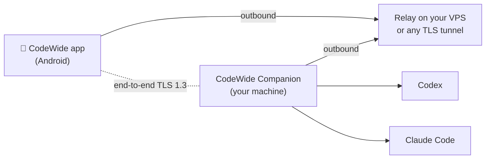

<p align="center">
  <picture>
    <source media="(prefers-color-scheme: dark)" srcset="brand/codewide-wordmark-inverse.svg">
    
  </picture>
</p>

<h3 align="center">Your coding agents, in your pocket.</h3>

<p align="center">
  Drive Codex and Claude Code on your own machine from your phone.<br>
  Start, steer, review and ship from wherever you are, without opening the laptop.
</p>

<p align="center">
  <a href="https://github.com/MrFlashAccount/CodeWide/releases/latest"></a>
  
  
  <a href="LICENSE"></a>
</p>

---

Coding agents work for minutes at a time. You don't need to sit and watch
them, but you do need to be reachable: to approve a command, answer a
question, glance at a diff or send the next task. CodeWide puts that loop on
your phone.

The agent keeps running on your computer, next to your code, your tools and
your logins. The phone is a full client for it, not a remote desktop and not a
chat bot that pastes code somewhere else.

## What it feels like

- **On the way home.** The agent you left running finished. Read the summary,
  scroll through the diff, ask for one more fix, put the phone away.
- **In a queue.** The agent stops at an approval. Tap allow, it keeps going.
- **On a walk.** Dictate the next task. It is queued and goes out as soon as
  the current turn ends.
- **On the couch.** Open the dev server the agent just changed in the built-in
  browser, with hot reload and DevTools, as if it ran on the phone.
- **Back at the desk.** Sessions you started with `claude` in a terminal are
  in the app's thread list, next to the ones you started from the phone.

## Features

**Agents**
- Codex and Claude Code side by side in one thread list, each thread bound to
  one agent.
- Fork a thread into the other agent: the new thread starts from a handoff of
  the conversation, the original stays untouched.
- Cross-provider subagents: an agent can start, wait for and message agents on
  either provider.
- Live activity in the thread list: see what each running agent is doing right
  now without opening it.

**Working from the phone**
- Approvals, plans, diffs, token usage and cost, rendered natively.
- A durable prompt queue: send while the agent is busy, the message goes out
  when the turn ends, even across reconnects.
- Voice dictation, transcribed by your machine through your own Codex
  sign-in. Audio is not stored on the phone.
- Files and images as attachments; resumable, checksum-verified transfers.
- A real terminal per thread, rooted in its working directory.
- Drafts, cache and outbox survive bad networks and app restarts.

**Your dev server on your phone**
- Ports from your machine appear on the phone as `127.0.0.1:<port>`.
  Vite, Docker Compose, Kubernetes port-forwards and other dev services are
  detected and forwarded automatically.
- HTTP, WebSockets and hot reload work unchanged.
- A built-in browser with Chromium DevTools: Elements, Console, Network,
  Performance.

**Several machines, one app**
- A server rail for your laptop, desktop and remote dev boxes.
- Adaptive layout for phones, tablets and unfolded foldables.

## How it works



- **Companion** runs next to your agents on macOS or Linux. It owns sessions,
  history, the prompt queue, files, terminals and port forwards.
- **The app** pairs with the Companion once by QR code and talks to it over
  an encrypted channel.
- **Relay** (optional) is a small server you run on your own VPS. The phone and
  your computer both connect *out* to it, so your machine needs no open ports,
  port forwarding or VPN. The relay only forwards encrypted bytes and cannot
  read them. Tailscale, ngrok or any TLS ingress works too.

There is no CodeWide cloud and no CodeWide account. Your code, history and
agent sign-ins stay on your machine, and the agents talk to OpenAI and
Anthropic exactly as they do when you run them in a terminal.

## Quick start

You need an Android phone (arm64) and a Mac (macOS 26+) or Linux x86_64
machine where `codex` is installed and signed in.

**1. Install the app.** Download `CodeWide-*.apk` from the
[latest release](https://github.com/MrFlashAccount/CodeWide/releases/latest)
and install it.

**2. Install the Companion** on the machine where your agents run.

<table>
<tr><th>macOS</th><th>Linux</th></tr>
<tr><td>

```sh
brew tap MrFlashAccount/codewide
brew install --cask codewide
```

A menu-bar app with a setup assistant. Builds are not notarized yet, so
macOS may ask you to approve it on first launch.

</td><td>

```sh
curl -fsSL https://raw.githubusercontent.com/MrFlashAccount/CodeWide/main/install/companion | sh
```

Installs a checksum-verified bundle and starts it as a user systemd service.

</td></tr>
</table>

**3. Make it reachable from the phone.** The simplest route is a relay on any
small VPS with a public IP:

```sh
curl -fsSL https://raw.githubusercontent.com/MrFlashAccount/CodeWide/main/install/relay | sh
```

Allow inbound TCP `8780`, then connect your computer to it:

- **macOS:** run `codewide-relay pair` on the VPS, choose **Add Relay** in the
  CodeWide menu-bar app, enter the address it prints and confirm the four
  matching symbols.
- **Linux:** run `codewide-relay invite` on the VPS, then
  `codewide-companion relay pair <vps-ip>:8780` on your machine and paste the
  invite.

Already have Tailscale, ngrok or a reverse proxy?
[Use that instead](docs/self-hosting.md#reach-the-companion-from-your-phone).

**4. Pair your phone.** On macOS the setup assistant ends with a QR code. On
Linux run:

```sh
codewide-companion pair
```

In the app, tap **Add server** and scan the code. It works once and expires in
five minutes.

**5. Optional: add Claude Code.** Install `claude` on the same machine and sign
in. The Companion picks it up; nothing else to configure.

## Requirements

| | |
|---|---|
| Phone | Android, arm64 |
| Computer | macOS 26+, or Linux x86_64 with systemd |
| Agents | Codex CLI, signed in (required). Claude Code, signed in (optional) |
| Network | Your own relay on a VPS, or any `wss://` endpoint you control |

The Companion uses the agents' own sign-ins on your machine. CodeWide never
reads or stores your agent credentials.

## Security

- **End-to-end encryption.** The app pins the Companion's identity and opens
  TLS 1.3 to it inside the carrier connection. Relays and tunnels see only
  encrypted bytes. There is no plaintext fallback.
- **Keys that can't leave the phone.** Each phone signs in with a
  non-exportable Android Keystore key. A copied token alone can't open a
  session.
- **One-time pairing.** QR codes are single-use and expire in five minutes.
- **Revocable access.** `codewide-companion devices` lists paired phones,
  `codewide-companion revoke <id>` cuts one off. On macOS this is in the menu.

A paired phone has the same access as you at the terminal: it can run agents,
open shells and read files on that machine. Pair only devices you own.

Details: [docs/self-hosting.md](docs/self-hosting.md#pairing-and-device-security).

## FAQ

**Does my computer need to stay on?**
Yes. The agents run on it, so it must be awake and online. A desktop, a home
server or a cloud dev box works best. A laptop works as long as it doesn't
go to sleep.

**Is there an iOS app?**
Not yet. CodeWide is Android-first.

**Does my code go through CodeWide's servers?**
There are none. The phone talks to your own machine, and a relay, if you use
one, runs on your own server and forwards only encrypted bytes. The agents
reach their model providers just as they do in a terminal.

**Do I need an API key?**
No. CodeWide uses whatever you are signed in with in `codex` and `claude` on
that machine, including ChatGPT and Claude subscriptions.

## Documentation

- [Self-hosting](docs/self-hosting.md): install options, relays and tunnels,
  pairing, terminal, port forwarding, file roots, telemetry.
- [Relay rollout](docs/relay-rollout.md): relay setup, canary and rollback.
- [macOS Companion](apps/companion-macos/README.md): the menu-bar app.
- [Agent providers](docs/agent-providers.md): how Codex and Claude plug in.
- [Development](docs/development.md): architecture, build, test and release.

## Contributing

CodeWide is a pnpm and Cargo monorepo: the Android app is Expo / React Native,
the Companion and relay are Rust, the macOS app is Swift.

```sh
pnpm install
pnpm typecheck
pnpm test
cargo test --workspace
```

Read [AGENTS.md](AGENTS.md) for repository rules and the checks each area
requires, and [docs/development.md](docs/development.md) for the full command
reference.

## License

[MIT](LICENSE)
