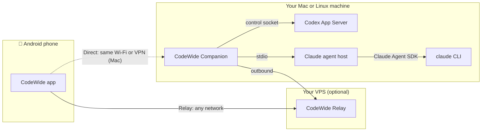

<p align="center">
  <picture>
    <source media="(prefers-color-scheme: dark)" srcset="brand/codewide-wordmark-inverse.svg">
    
  </picture>
</p>

<h3 align="center">Codex and Claude Code on your own machine. Run the day from your phone.</h3>

<p align="center">
  Self-hosted end to end: no CodeWide cloud, no account, your own relay.<br>
  Start, steer, review and ship from Android, and open the laptop only when you have to.
</p>

<p align="center">
  <a href="https://github.com/MrFlashAccount/CodeWide/releases/latest"></a>
  
  
  
  <a href="LICENSE"></a>
</p>

<!--
  SCREENSHOT PLACEHOLDER: hero
  One row of three phone frames, light or dark to match the wordmark:
    1. Thread list with Codex and Claude threads side by side and live activity lines.
    2. A diff open in the review editor with a line comment being dictated.
    3. The built-in browser on a dev server with the DevTools Console open.
  Target: docs/assets/readme/hero.png, 1600 px wide. Or a 20-second GIF of the same loop.
-->

---

Coding agents work for minutes at a time, and the agent only needs you at a
few points: approve a command, answer a question, look at what it made, send
the next task. None of that needs a keyboard. CodeWide puts the whole loop on
an Android phone and leaves everything else where it is.

Everything is yours and runs on hardware you control. The agents, your code,
your terminals and your sign-ins stay on your Mac or Linux box. The phone talks
to that machine directly or through a relay you run yourself. There is no
CodeWide account, no CodeWide server and nothing to trust in the middle.

## Why not the official remote?

Claude Code has Remote Control and Codex has Remote in the ChatGPT app. Both
are good if you drive one agent, your host is a Mac or Windows PC with the
vendor's desktop app, and routing the session through the vendor's servers is
fine with you.

CodeWide is for when that is not enough:

- **Nothing between your phone and your machine but you.** A direct, pinned
  TLS 1.3 connection to the Companion, over the LAN, a VPN or your own relay.
  No vendor relay, no third-party relay, no account.
- **Both agents in one place.** Codex and Claude Code threads in one list,
  fork a thread into the other agent, and let either agent spawn subagents on
  the other.
- **A headless Linux box is a first-class host.** A home server or a cloud
  dev box with no desktop app and no screen.
- **Review anything, not just read it.** Line comments on diffs, highlights in
  Markdown, points on images and diagrams, element reports from a web page.
  The comments go back to the agent as one message.
- **See what it built.** Your dev server opens on the phone at
  `127.0.0.1`, with hot reload and Chromium DevTools.
- **A real terminal** in every thread's working directory.

CodeWide is not for you yet if your phone is an iPhone, your host is Windows,
or you want a cloud VM that keeps working while your laptop sleeps.

## What you do from the phone

### Review, and talk back

<!--
  SCREENSHOT PLACEHOLDER: review
  Left: diff in the code review editor with two line comments.
  Right: a Markdown plan with a highlighted sentence and the comment box open.
-->

- **Diffs** in a code review editor with line comments. Dictate a comment and
  it lands on the line you selected.
- **Plans, answers and documents**: select a passage in any Markdown the agent
  produced and comment on it.
- **Images and diagrams**: tap a point on a screenshot or a Mermaid diagram and
  say what is wrong there. Draw on an image to mark it up.
- **Web pages**: in the built-in browser, pick an element and send its
  selector, HTML, console errors and a screenshot to the thread you choose.
- Every comment set becomes one attachment on your next message, so the agent
  gets the context and the exact anchor.

### Steer

- **Approvals and questions** as native cards, with the command, the reason
  and the directory in view. Tap allow, the agent keeps going.
- **A durable prompt queue.** Send while the agent is busy; the message goes
  out when the turn ends, even across reconnects and app restarts. Reorder or
  steer the queue before it is sent.
- **Voice dictation**, transcribed on your machine through your own Codex
  sign-in. Audio is not stored on the phone.
- **Fork into the other agent.** The new thread starts from a handoff of the
  conversation; the original stays untouched.
- **Cross-provider subagents.** An agent can start, wait for and message agents
  on either provider from inside its own run.
- **Goals (Codex)**: give a thread an objective and a token budget, pause and
  resume it, see the accumulated time.
- **Token usage and cost**, rendered natively next to the turn.
- **Live activity in the thread list**: what every running agent is doing
  right now, without opening it.

### See what it built

<!--
  SCREENSHOT PLACEHOLDER: dev-server
  The built-in browser on a Vite app with the DevTools Network tab open and
  the port chip visible in the composer.
-->

- Ports from your machine appear on the phone as `127.0.0.1:<port>`. Vite,
  Docker Compose, Kubernetes port-forwards and other dev services are detected
  and forwarded automatically.
- HTTP, WebSockets and hot reload work unchanged.
- A built-in browser with Chromium DevTools: Elements, Console, Network,
  Performance. Tabs and pages stay mounted while you switch back to the
  conversation.

### Go beyond chat

- **A real terminal per thread**, rooted in its working directory, with tabs
  that survive minimizing.
- **Files and images** in both directions, with resumable, checksum-verified
  transfers.
- **Search** across the history of every thread on every machine.
- **Sessions you started in a terminal** with `claude` are in the thread list,
  next to the ones you started from the phone.
- **Several machines, one app.** A server rail for your laptop, desktop and
  remote dev boxes. Adaptive layout for phones, tablets and unfolded foldables.
- **Global voice mode (Codex, early).** A floating orb over any app. Talk to an
  assistant that starts tasks in new chats, checks what is running and reports
  back.

## How it works



- **Companion** runs on the machine with your code. It connects to the Codex
  App Server you already have and, if `claude` is signed in, starts a small
  Claude agent host. It owns threads, history, the prompt queue, files,
  terminals and port forwards.
- **The app** pairs with the Companion once by QR code. Whichever route it
  takes, it opens TLS 1.3 straight to the Companion and pins its identity.
- **Relay** is a small server you run on any VPS. The phone and your computer
  both connect *out* to it, so your machine needs no open ports and the phone
  works from any network. The relay forwards only encrypted bytes.
- **Direct** (Mac) skips the relay when the phone can reach the Mac itself:
  same Wi-Fi, or a VPN such as Tailscale.

There is no CodeWide cloud and no CodeWide account. Your code, history and
agent sign-ins stay on your machine, and the agents talk to OpenAI and
Anthropic exactly as they do when you run them in a terminal. CodeWide never
reads or stores your agent credentials.

### Security

- **End-to-end encryption.** The app pins the Companion's identity and opens
  TLS 1.3 to it inside the carrier connection. Relays and tunnels see only
  encrypted bytes. There is no plaintext fallback.
- **Keys that can't leave the phone.** Each phone signs in with a
  non-exportable Android Keystore key. A copied token alone can't open a
  session.
- **One-time pairing.** QR codes are single-use and expire in five minutes.
- **Revocable access.** On a Mac, remove a device from the menu bar. On
  Linux, `codewide-companion devices` lists paired phones and
  `codewide-companion revoke <id>` cuts one off.

A paired phone has the same access as you at the terminal: it can run agents,
open shells and read files on that machine. Pair only devices you own.
Details: [pairing and device security](docs/self-hosting.md#pairing-and-device-security).

## Get started

| | |
|---|---|
| Phone | Android, arm64 |
| Computer | Mac with Apple Silicon and macOS 26+, or Linux x86_64 with systemd |
| Agents | Codex CLI 0.155.1+, signed in (required). Claude Code, signed in (optional) |
| Network | Same Wi-Fi or VPN (Mac), your own relay on a VPS, or any `wss://` endpoint you control |

No API keys: CodeWide uses whatever you are signed in with in `codex` and
`claude` on that machine, including ChatGPT and Claude subscriptions.

### On a Mac

```sh
brew tap MrFlashAccount/codewide
brew trust --cask MrFlashAccount/codewide/codewide
brew install --cask MrFlashAccount/codewide/codewide
xattr -dr com.apple.quarantine /Applications/CodeWide.app   # self-signed for now
open -a CodeWide
```

The setup assistant opens on first launch and walks you through three steps:
it finds your Codex sign-in, asks whether to use the same network or a relay,
and shows a QR code. Install `CodeWide-*.apk` from the
[latest release](https://github.com/MrFlashAccount/CodeWide/releases/latest)
on the phone, tap **Add server**, scan the code, open your Mac in the app and
send Codex a message. On the same network or a VPN there is nothing else to
set up.

To work over mobile data, put a relay on any Linux VPS during the assistant's
relay step:

```sh
curl -fsSL https://raw.githubusercontent.com/MrFlashAccount/CodeWide/main/install/relay | sh
codewide-relay pair
```

Step by step, with every branch of the assistant:
[Getting started](docs/getting-started.md).

### On a Linux server

For a headless x86_64 machine with systemd, over SSH:

```sh
codex app-server daemon start                                   # Codex CLI installed and signed in
curl -fsSL https://raw.githubusercontent.com/MrFlashAccount/CodeWide/main/install/companion | sh
codewide-companion relay pair <relay-ip>:8780                   # paste the invite from `codewide-relay invite`
codewide-companion pair                                         # shows the QR code
```

On the phone, tap **Add server** and scan the code. Prefer your own TLS
ingress over a relay? See
[self-hosting](docs/self-hosting.md#reach-the-companion-from-your-phone).

### Add Claude Code

Install `claude` on the same machine and sign in. The Companion picks it up;
nothing else to configure.

## FAQ

**Does my computer need to stay on?**
Yes, the agents run on it. On a Mac, Keep Awake prevents idle sleep while
plugged in (or always, or never: your choice in the menu). Closing a MacBook's
lid still puts it to sleep unless an external display is connected. A
desktop, home server or cloud dev box avoids the question entirely.

**Is there an iOS app?**
Not yet. CodeWide is Android-first, and parts of it, such as the floating
voice orb over other apps and the sideloaded releases, lean on what Android
allows. An iOS client is not planned at the moment.

**Does my code go through CodeWide's servers?**
There are none. The phone talks to your own machine, and a relay, if you use
one, runs on your own server and forwards only encrypted bytes. The agents
reach their model providers just as they do in a terminal.

**Do I need an API key?**
No. CodeWide uses whatever you are signed in with in `codex` and `claude` on
that machine, including ChatGPT and Claude subscriptions.

**What works with Claude Code and what is Codex-only?**
Threads, approvals, questions, diffs, the prompt queue, attachments, forks
into the other agent, subagents, search and the terminal work with both.
Goals, global voice mode, background process lists and the account pool are
Codex-only today. The full matrix is in
[agent providers](docs/agent-providers.md).

**Is pairing safe over a relay?**
The QR code carries a one-time secret and expires in five minutes. The relay
only sees TLS 1.3 bytes between the phone and the Companion. A paired phone
has your access on that machine, so pair only devices you own and revoke ones
you lose.

## Documentation

- [Getting started](docs/getting-started.md): the Mac setup assistant step by
  step, relay setup, first connection checks.
- [Self-hosting](docs/self-hosting.md): install options, relays and tunnels,
  pairing, terminal, port forwarding, file roots, telemetry.
- [Relay rollout](docs/relay-rollout.md): relay setup, canary and rollback.
- [macOS Companion](apps/companion-macos/README.md): the menu-bar app.
- [Agent providers](docs/agent-providers.md): how Codex and Claude plug in,
  and which capabilities each one has.
- [Development](docs/development.md): architecture, build, test and release.

## Contributing

CodeWide is a pnpm and Cargo monorepo: the Android app is Expo / React Native,
the Companion and relay are Rust, the macOS app is Swift.

```sh
pnpm install
pnpm typecheck
pnpm test
cargo test --workspace
```

Read [AGENTS.md](AGENTS.md) for repository rules and the checks each area
requires, and [docs/development.md](docs/development.md) for the full command
reference.

## License

[MIT](LICENSE)
