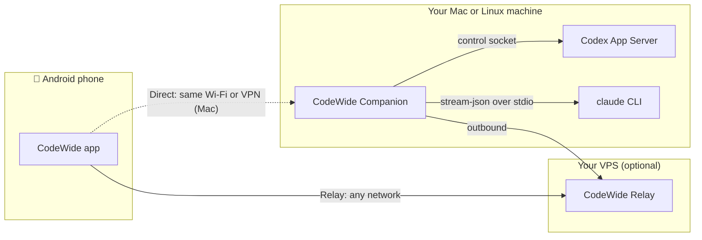

<p align="center">
  <picture>
    <source media="(prefers-color-scheme: dark)" srcset="brand/codewide-wordmark-inverse.svg">
    
  </picture>
</p>

<h3 align="center">Codex and Claude Code on your own machine. Run the day from your phone.</h3>

<p align="center">
  No CodeWide cloud. No account. Your own relay.<br>
  Approve, review, steer and ship from Android. Open the laptop only when you have to.
</p>

<p align="center">
  <a href="https://github.com/MrFlashAccount/CodeWide/releases/latest"></a>
  
  
  
  <a href="LICENSE"></a>
</p>

<!--
  SCREENSHOT PLACEHOLDER: hero
  Three phone frames in a row, or a 20-second GIF:
    1. Thread list, Codex and Claude side by side, live activity lines.
    2. A diff in the review editor, a line comment being dictated.
    3. The built-in browser on a dev server, DevTools Console open.
  Target: docs/assets/readme/hero.png, 1600 px wide.
-->

---

An agent runs for minutes and needs you at a few points: **approve**, **answer**,
**look**, **send the next task**. None of that needs a keyboard.

CodeWide puts that loop on an Android phone. Everything else stays on your Mac
or Linux box: the agents, the code, the terminals, the sign-ins.

## Why CodeWide

**The official remotes are fine** if you drive one agent, your host runs the
vendor's desktop app, and the session may pass through the vendor's servers.

**CodeWide is for the rest:**

- **Nothing in the middle.** Pinned TLS 1.3 from phone to machine. LAN, VPN or your own relay.
- **Both agents.** Codex and Claude Code in one list. Fork a thread into the other agent.
- **Headless Linux hosts.** A home server or a cloud box, no desktop app, no screen.
- **Review anything.** Comments on diffs, Markdown, images, diagrams and web pages.
- **Your dev server on the phone.** `127.0.0.1:<port>`, hot reload, Chromium DevTools.
- **A real terminal** in every thread.

**Not for you yet** if your phone is an iPhone, your host is Windows, or you
want a cloud VM that outlives a sleeping laptop.

## From the phone

### Review, and talk back

<!--
  SCREENSHOT PLACEHOLDER: review
  Left: a diff with two line comments. Right: a Markdown plan with a
  highlighted sentence and the comment box open.
-->

- **Diffs.** Line comments in a code review editor. Dictate one, it lands on the line.
- **Plans and answers.** Highlight a passage in any Markdown and comment on it.
- **Images and diagrams.** Tap a point on a screenshot or a Mermaid diagram. Draw on it.
- **Web pages.** Pick an element in the built-in browser. Its selector, HTML, console errors and a screenshot go to the thread.
- **One attachment.** Every comment set goes out with your next message, anchors included.

### Steer

- **Approvals and questions** as native cards: command, reason, directory. Tap allow.
- **Prompt queue.** Send while the agent is busy. Survives reconnects and restarts.
- **Voice.** Dictation transcribed on your machine through your Codex sign-in. No audio kept on the phone.
- **Fork into the other agent.** New thread, handoff of the conversation, original untouched.
- **Subagents across providers.** Either agent can start, wait for and message agents on the other.
- **Goals (Codex).** An objective and a token budget. Pause, resume, see the time spent.
- **Live activity** in the thread list. See what every agent is doing without opening it.
- **Token usage and cost** next to every turn.

### See what it built

<!--
  SCREENSHOT PLACEHOLDER: dev-server
  The built-in browser on a Vite app, DevTools Network tab open, port chip
  visible in the composer.
-->

- **Ports arrive on the phone** as `127.0.0.1:<port>`. Vite, Docker Compose and `kubectl port-forward` are detected automatically.
- **HTTP, WebSockets and hot reload** work unchanged.
- **Chromium DevTools**: Elements, Console, Network, Performance.

### Beyond chat

- **Terminal per thread**, rooted in its working directory. Tabs survive minimizing.
- **Files and images** both ways. Resumable, checksum-verified.
- **Search** across every thread on every machine.
- **Terminal sessions** you started with `claude` show up in the thread list.
- **Several machines, one app.** Phones, tablets, unfolded foldables.
- **Global voice mode (Codex, early).** A floating orb over any app that starts tasks and reports back.

## How it works



- **Companion** runs next to your code. Drives the Codex App Server and your own `claude` CLI directly. Owns threads, history, queue, files, terminals, ports.
- **App** pairs once by QR code, then opens TLS 1.3 straight to the Companion and pins its identity.
- **Relay** is a small server on your VPS. Both sides connect out. It forwards encrypted bytes only.
- **Direct** (Mac) skips the relay on the same Wi-Fi or a VPN such as Tailscale.

**No CodeWide cloud, no CodeWide account.** The agents talk to OpenAI and
Anthropic exactly as they do in your terminal. CodeWide never reads your agent
credentials.

### Security

- **End-to-end.** Pinned identity, TLS 1.3 inside the carrier connection, no plaintext fallback.
- **Keys stay on the phone.** Non-exportable Android Keystore key. A copied token can't open a session.
- **One-time pairing.** QR codes are single-use and expire in five minutes.
- **Revocable.** Remove a device from the Mac menu bar or `codewide-companion revoke <id>` on Linux.

A paired phone has your access on that machine. Pair only devices you own.
[Details](docs/self-hosting.md#pairing-and-device-security).

## Get started

| | |
|---|---|
| **Phone** | Android, arm64 |
| **Computer** | Mac with Apple Silicon, macOS 26+. Or Linux x86_64 with systemd |
| **Agents** | Codex CLI 0.155.1+, signed in. Claude Code, signed in (optional) |
| **Network** | Same Wi-Fi or VPN (Mac). Your own relay on a VPS. Or any `wss://` endpoint you control |
| **API keys** | None. Uses the `codex` and `claude` sign-ins on that machine, subscriptions included |

### Mac

```sh
brew tap MrFlashAccount/codewide
brew trust --cask MrFlashAccount/codewide/codewide
brew install --cask MrFlashAccount/codewide/codewide
xattr -dr com.apple.quarantine /Applications/CodeWide.app   # self-signed for now
open -a CodeWide
```

1. The setup assistant finds your Codex sign-in.
2. Pick **Use Direct** (same network or VPN) or set up a relay on a VPS:
   ```sh
   curl -fsSL https://raw.githubusercontent.com/MrFlashAccount/CodeWide/main/install/relay | sh
   codewide-relay pair
   ```
3. Install the APK from the [latest release](https://github.com/MrFlashAccount/CodeWide/releases/latest), tap **Add server**, scan the QR code.
4. Open your Mac in the app and send Codex a message.

Every branch of the assistant, step by step: [Getting started](docs/getting-started.md).

### Linux server

```sh
codex app-server daemon start                   # Codex CLI installed and signed in
curl -fsSL https://raw.githubusercontent.com/MrFlashAccount/CodeWide/main/install/companion | sh
codewide-companion relay pair <relay-ip>:8780   # invite from `codewide-relay invite`
codewide-companion pair                         # QR code
```

Own TLS ingress instead of a relay: [self-hosting](docs/self-hosting.md#reach-the-companion-from-your-phone).

### Claude Code

Install `claude` on the same machine and sign in. The Companion picks it up.

## FAQ

**Does my computer need to stay on?**
Yes. **Keep Awake** in the Mac menu bar prevents idle sleep. A closed lid still sleeps unless an external display is connected.

**Is there an iOS app?**
Not yet. CodeWide is Android-first.

**Does my code go through CodeWide's servers?**
There are none. Phone to your machine, optionally through a relay you run.

**What is Codex-only?**
Goals, global voice mode, background process lists and the account pool. Everything else works with both. [Full matrix](docs/agent-providers.md).

**Is pairing safe over a relay?**
The QR code is a one-time secret that expires in five minutes. The relay sees TLS bytes only. Revoke a phone you lose.

## Documentation

- [Getting started](docs/getting-started.md): the Mac assistant step by step, relay, first checks.
- [Self-hosting](docs/self-hosting.md): install options, relays and tunnels, pairing, terminal, ports, telemetry.
- [Relay rollout](docs/relay-rollout.md): setup, canary, rollback.
- [macOS Companion](apps/companion-macos/README.md): the menu-bar app.
- [Agent providers](docs/agent-providers.md): how Codex and Claude plug in, capability matrix.
- [Development](docs/development.md): architecture, build, test, release.

## Contributing

pnpm and Cargo monorepo. Android app: Expo / React Native. Companion and relay: Rust. macOS app: Swift.

```sh
pnpm install
pnpm typecheck
pnpm test
cargo test --workspace
```

Rules and per-area checks: [AGENTS.md](AGENTS.md). Full command reference: [docs/development.md](docs/development.md).

## License

[MIT](LICENSE)
