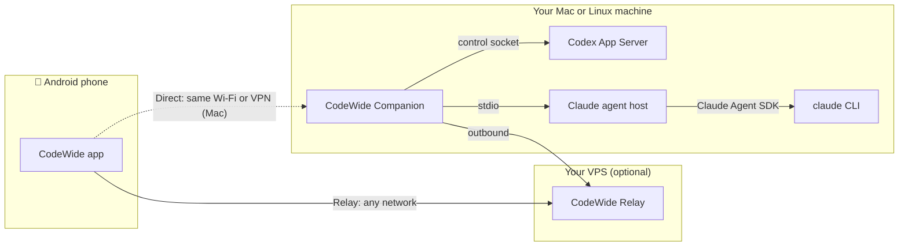

<p align="center">
  <picture>
    <source media="(prefers-color-scheme: dark)" srcset="brand/codewide-wordmark-inverse.svg">
    
  </picture>
</p>

<h3 align="center">Your coding agents, in your pocket.</h3>

<p align="center">
  Drive Codex and Claude Code on your own machine from your phone.<br>
  Start, steer, review and ship from wherever you are, without opening the laptop.
</p>

<p align="center">
  <a href="https://github.com/MrFlashAccount/CodeWide/releases/latest"></a>
  
  
  <a href="LICENSE"></a>
</p>

---

Coding agents work for minutes at a time. You don't need to sit and watch
them, but you do need to be reachable: to approve a command, answer a
question, glance at a diff or send the next task. CodeWide puts that loop on
your phone.

The agent keeps running on your computer, next to your code, your tools and
your logins. The phone is a full client for it, not a remote desktop and not a
chat bot that pastes code somewhere else.

## What it feels like

- **On the way home.** The agent you left running finished. Read the summary,
  scroll through the diff, ask for one more fix, put the phone away.
- **In a queue.** The agent stops at an approval. Tap allow, it keeps going.
- **On a walk.** Dictate the next task. It is queued and goes out as soon as
  the current turn ends.
- **On the couch.** Open the dev server the agent just changed in the built-in
  browser, with hot reload and DevTools, as if it ran on the phone.
- **Back at the desk.** Sessions you started with `claude` in a terminal are
  in the app's thread list, next to the ones you started from the phone.

## Features

**Agents**
- Codex and Claude Code side by side in one thread list, each thread bound to
  one agent.
- Fork a thread into the other agent: the new thread starts from a handoff of
  the conversation, the original stays untouched.
- Cross-provider subagents: an agent can start, wait for and message agents on
  either provider.
- Live activity in the thread list: see what each running agent is doing right
  now without opening it.

**Working from the phone**
- Approvals, plans, diffs, token usage and cost, rendered natively.
- A durable prompt queue: send while the agent is busy, the message goes out
  when the turn ends, even across reconnects.
- Voice dictation, transcribed by your machine through your own Codex
  sign-in. Audio is not stored on the phone.
- Files and images as attachments; resumable, checksum-verified transfers.
- A real terminal per thread, rooted in its working directory.
- Drafts, cache and outbox survive bad networks and app restarts.
- Global voice mode (Codex, early): a floating orb over any app. Talk to an
  assistant that starts tasks in new chats, checks what is running and
  reports back.

**Your dev server on your phone**
- Ports from your machine appear on the phone as `127.0.0.1:<port>`.
  Vite, Docker Compose, Kubernetes port-forwards and other dev services are
  detected and forwarded automatically.
- HTTP, WebSockets and hot reload work unchanged.
- A built-in browser with Chromium DevTools: Elements, Console, Network,
  Performance.

**Several machines, one app**
- A server rail for your laptop, desktop and remote dev boxes.
- Adaptive layout for phones, tablets and unfolded foldables.

## How it works



- **Companion** runs on the machine with your code. It connects to the Codex
  App Server you already have and, if `claude` is signed in, starts a small
  Claude agent host. It owns threads, history, the prompt queue, files,
  terminals and port forwards.
- **The app** pairs with the Companion once by QR code. Whichever route it
  takes, it opens TLS 1.3 straight to the Companion and pins its identity.
- **Relay** is a small server you run on any VPS. The phone and your computer
  both connect *out* to it, so your machine needs no open ports and the phone
  works from any network. The relay forwards only encrypted bytes.
- **Direct** (Mac) skips the relay when the phone can reach the Mac itself:
  same Wi-Fi, or a VPN such as Tailscale.

There is no CodeWide cloud and no CodeWide account. Your code, history and
agent sign-ins stay on your machine, and the agents talk to OpenAI and
Anthropic exactly as they do when you run them in a terminal.

## Quick start

### On a Mac

You need a Mac with Apple Silicon and macOS 26+, and an Android phone. A relay
is optional: without one, the phone connects over the same network or a VPN.

**1. Install and open CodeWide.** If you don't have Homebrew yet, install it
from [brew.sh](https://brew.sh/) and run the *Next steps* it prints. Then:

```sh
brew update
brew tap MrFlashAccount/codewide
brew trust --cask MrFlashAccount/codewide/codewide
brew install --cask MrFlashAccount/codewide/codewide
```

CodeWide is self-signed for now. Homebrew
[removed `--no-quarantine`](https://github.com/Homebrew/brew/pull/23363), so
clear the quarantine flag on CodeWide only and launch it:

```sh
xattr -dr com.apple.quarantine /Applications/CodeWide.app
open -a CodeWide
```

The setup assistant opens by itself on first launch.

**2. Setup → Codex.** Follow the assistant:

- If it offers **Open Login Items**, allow CodeWide to run in the background.
- If the Codex CLI isn't installed yet, install it and sign in
  ([OpenAI's instructions](https://developers.openai.com/codex/cli)):

  ```sh
  brew install --cask codex
  codex
  ```

  Choose **Sign in with ChatGPT**, then return to the assistant and click
  **Scan Again**.
- Pick a Codex profile if the assistant asks.
- If you see **Start Codex**, click it.

**3. Setup → Relay (optional).**

- *Same network or VPN:* click **Use Direct** and go to step 4. No server
  needed.
- *Over the internet:* you need a Linux x86_64 server with systemd, for
  example Ubuntu 24.04. Click **Set Up Relay…** and run on the server:

  ```sh
  curl -fsSL https://raw.githubusercontent.com/MrFlashAccount/CodeWide/main/install/relay | sh
  ```

  The relay starts right away and after every reboot. Allow inbound TCP
  `8780` in the server firewall and your provider's network rules, then run:

  ```sh
  codewide-relay pair
  ```

  Keep that terminal open. On the Mac, enter the `IP:port` it shows and
  click **Connect**. Check that the Mac and the server show the same four
  symbols, and press Enter in the server terminal. When you see
  **Relay connected**, click **Done**, then **Continue**. If the one-minute
  window runs out, run `codewide-relay pair` again.

**4. Setup → Your phone.** The Mac shows a QR code. On Android:

1. Download `CodeWide-*.apk` from the
   [latest release](https://github.com/MrFlashAccount/CodeWide/releases/latest).
2. Open it and allow installs from this source if Android asks.
3. Launch CodeWide and tap **Add server**.
4. Scan the QR code on the Mac.

You don't type the Mac's or the relay's address on the phone. If the code
expires, click **New Code** on the Mac. Don't share it: it contains a
connection secret. When the phone shows up in the assistant, click
**Finish Setup**.

**5. Check the connection.** Open your Mac in the app and send Codex a
message.

- Without a relay, the phone has to stay on the same network or VPN.
- With a relay, turn off Wi-Fi on the phone and try over mobile data.

The Mac has to stay on and awake. **Keep Awake** in the menu bar prevents idle
sleep while it is plugged in.

### On a Linux server

For a headless x86_64 machine with systemd, over SSH:

```sh
# 1. Start Codex's App Server (Codex CLI must be installed and signed in)
codex app-server daemon start

# 2. Install the Companion as a user service
curl -fsSL https://raw.githubusercontent.com/MrFlashAccount/CodeWide/main/install/companion | sh

# 3. Connect it to your relay: run `codewide-relay invite` on the relay
#    host, then paste the invite here
codewide-companion relay pair <relay-ip>:8780

# 4. Show a pairing QR code
codewide-companion pair
```

On the phone, tap **Add server** and scan the code. It works once and expires
in five minutes. Prefer your own TLS ingress over a relay? See
[self-hosting](docs/self-hosting.md#reach-the-companion-from-your-phone).

### Relay for a Linux Companion

Install the relay on a server with a public IP as in step 3 above, allow TCP
`8780`, then run `codewide-relay invite` there and paste its output into
`codewide-companion relay pair <relay-ip>:8780` on your Linux machine.

### Add Claude Code

Install `claude` on the same machine and sign in. The Companion picks it up;
nothing else to configure.

## Requirements

| | |
|---|---|
| Phone | Android, arm64 |
| Computer | Mac with Apple Silicon and macOS 26+, or Linux x86_64 with systemd |
| Agents | Codex CLI 0.155.1+, signed in (required). Claude Code, signed in (optional) |
| Network | Same Wi-Fi or VPN (Mac), your own relay on a VPS, or any `wss://` endpoint you control |

The Companion uses the agents' own sign-ins on your machine. CodeWide never
reads or stores your agent credentials.

## Security

- **End-to-end encryption.** The app pins the Companion's identity and opens
  TLS 1.3 to it inside the carrier connection. Relays and tunnels see only
  encrypted bytes. There is no plaintext fallback.
- **Keys that can't leave the phone.** Each phone signs in with a
  non-exportable Android Keystore key. A copied token alone can't open a
  session.
- **One-time pairing.** QR codes are single-use and expire in five minutes.
- **Revocable access.** On a Mac, remove a device from the menu bar. On
  Linux, `codewide-companion devices` lists paired phones and
  `codewide-companion revoke <id>` cuts one off.

A paired phone has the same access as you at the terminal: it can run agents,
open shells and read files on that machine. Pair only devices you own.

Details: [docs/self-hosting.md](docs/self-hosting.md#pairing-and-device-security).

## FAQ

**Does my computer need to stay on?**
Yes, the agents run on it. On a Mac, Keep Awake prevents idle sleep while
plugged in (or always, or never: your choice in the menu). Closing a MacBook's
lid still puts it to sleep unless an external display is connected. A
desktop, home server or cloud dev box avoids the question entirely.

**Is there an iOS app?**
Not yet. CodeWide is Android-first.

**Does my code go through CodeWide's servers?**
There are none. The phone talks to your own machine, and a relay, if you use
one, runs on your own server and forwards only encrypted bytes. The agents
reach their model providers just as they do in a terminal.

**Do I need an API key?**
No. CodeWide uses whatever you are signed in with in `codex` and `claude` on
that machine, including ChatGPT and Claude subscriptions.

## Documentation

- [Self-hosting](docs/self-hosting.md): install options, relays and tunnels,
  pairing, terminal, port forwarding, file roots, telemetry.
- [Relay rollout](docs/relay-rollout.md): relay setup, canary and rollback.
- [macOS Companion](apps/companion-macos/README.md): the menu-bar app.
- [Agent providers](docs/agent-providers.md): how Codex and Claude plug in.
- [Development](docs/development.md): architecture, build, test and release.

## Contributing

CodeWide is a pnpm and Cargo monorepo: the Android app is Expo / React Native,
the Companion and relay are Rust, the macOS app is Swift.

```sh
pnpm install
pnpm typecheck
pnpm test
cargo test --workspace
```

Read [AGENTS.md](AGENTS.md) for repository rules and the checks each area
requires, and [docs/development.md](docs/development.md) for the full command
reference.

## License

[MIT](LICENSE)
